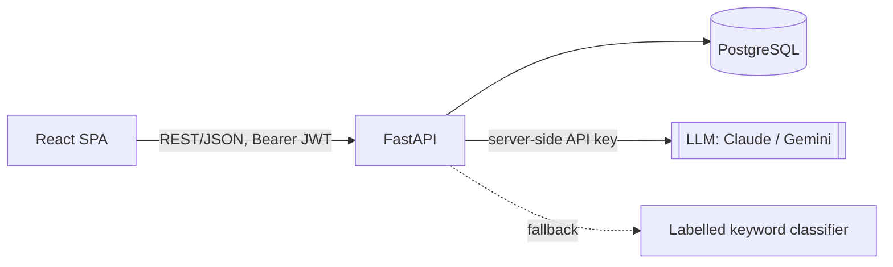

# 02 – System Architecture

Diagram: [diagrams/system_architecture.md](diagrams/system_architecture.md)

## Architectural style
A simple **two-tier web application** (SPA + monolithic REST API + relational database). A modular monolith was chosen over
microservices deliberately: one team, one deployable, a one-day build window and a workload that does not need independent
scaling. Router/service separation keeps it easy to split later.

## Frontend (`frontend/`)
- React 18 + Vite, React Router for routing, Recharts for charts, plain CSS (accessible, responsive, skip-link, focus states).
- `src/api.js` – single fetch wrapper (adds JWT, normalises errors, blob download for protected attachments).
- `src/auth.jsx` – auth context (login/register/logout, token restore, auto-logout on 401).
- `RequireRole` guards routes by role. **UI guards are convenience only; the backend enforces all authorisation.**
- Pages: public (`Home`, `StaticPages`, `Departments`, `Contact`, `Track`), auth, citizen (`Dashboard`, `Submit`),
  shared `GrievanceDetail` with role-specific panels, `cmo/Dashboard`, `officer/Dashboard`.
- Token storage: `localStorage` (simple for the prototype; an HttpOnly cookie would be preferable in production to limit XSS exposure).

## Backend (`backend/app/`)
| Module | Responsibility |
|---|---|
| `main.py` | App factory, CORS (explicit origins), security headers, table creation, first-run seeding, health check |
| `config.py` | Environment-based settings (Pydantic Settings) |
| `database.py`, `models.py` | SQLAlchemy 2 engine/session and the 8 tables |
| `security.py`, `deps.py` | bcrypt hashing, JWT creation/verification, in-memory rate limiter, `require_roles()` dependency |
| `schemas.py` | Request validation (Pydantic): mobile format, password rules, enumerations, lengths |
| `routers/` | `auth`, `public`, `grievances`, `cmo`, `officer`, `ai` |
| `services/workflow.py` | Transition matrix, history writing, access control, visibility filtering, serialisation |
| `services/files.py` | Upload validation (size, MIME allow-list, magic-byte signature) |
| `services/ai_service.py` | LLM call, output validation, cache, fallback, duplicate detection |
| `seed.py` | Fictional demo data |

### Key design decisions
1. **Authorisation in the backend.** Role via JWT claim *plus* DB re-check on each request (deactivated users are rejected).
   Object-level checks (`can_view`) ensure a citizen sees only their own grievances and an officer only their department's.
   "Not yours" and "does not exist" both return 404 to prevent reference enumeration.
2. **State machine.** `ALLOWED_TRANSITIONS` defines which role may move between which statuses. `Resolved` is reachable
   **only** by the CMO accepting an action-taken report; `Reopened` only by the citizen with a reason.
3. **Append-only audit trail.** `grievance_history` stores action, from/to status, remarks, visibility, actor id/role, timestamp.
   Remark visibility (`public` / `department` / `internal`) is enforced when serialising so citizens never see internal notes.
4. **SLA / overdue.** `due_date = created_at + {High 7, Medium 15, Low 30} days`; overdue = not Resolved and `due_date < now`.
   Computed in SQL for counts/filters, so dashboard numbers equal list results.
5. **Files in PostgreSQL.** Stored as `BYTEA` (≤ 5 MB) so they survive ephemeral container disks on free hosts. For large
   scale, move to object storage (S3/GCS) and keep metadata in the DB.
6. **AI is advisory.** Suggestions are stored separately (`ai_*` columns) from the human decision (`category`, `priority`,
   `department_id`); CMO confirmation is recorded in the audit trail.

## Database
PostgreSQL, see [03_Database_Design.md](03_Database_Design.md) and [diagrams/er_diagram.md](diagrams/er_diagram.md).

## API
REST over HTTPS, JSON (multipart for uploads), OpenAPI docs at `/docs`. See [04_API_Documentation.md](04_API_Documentation.md).

## AI architecture
See [05_AI_Integration.md](05_AI_Integration.md). In short: server-side call to an LLM with a constrained JSON contract;
output validated against allowed departments/categories/priorities; labelled fallback when the model is unavailable.

## Non-functional notes
- **Security:** bcrypt, JWT (8 h), rate limits on login/register/contact/track/submit/AI, strict CORS, upload validation,
  `X-Content-Type-Options`, `X-Frame-Options`, generic login errors, parameterised queries via ORM, secrets only in env.
- **Observability:** `/api/health`, structured logging of AI fallbacks (no complaint text logged).
- **Scalability path:** stateless API (horizontal scaling), move rate limiter to Redis, add Alembic migrations, object storage,
  background job for notifications, pagination already implemented.
